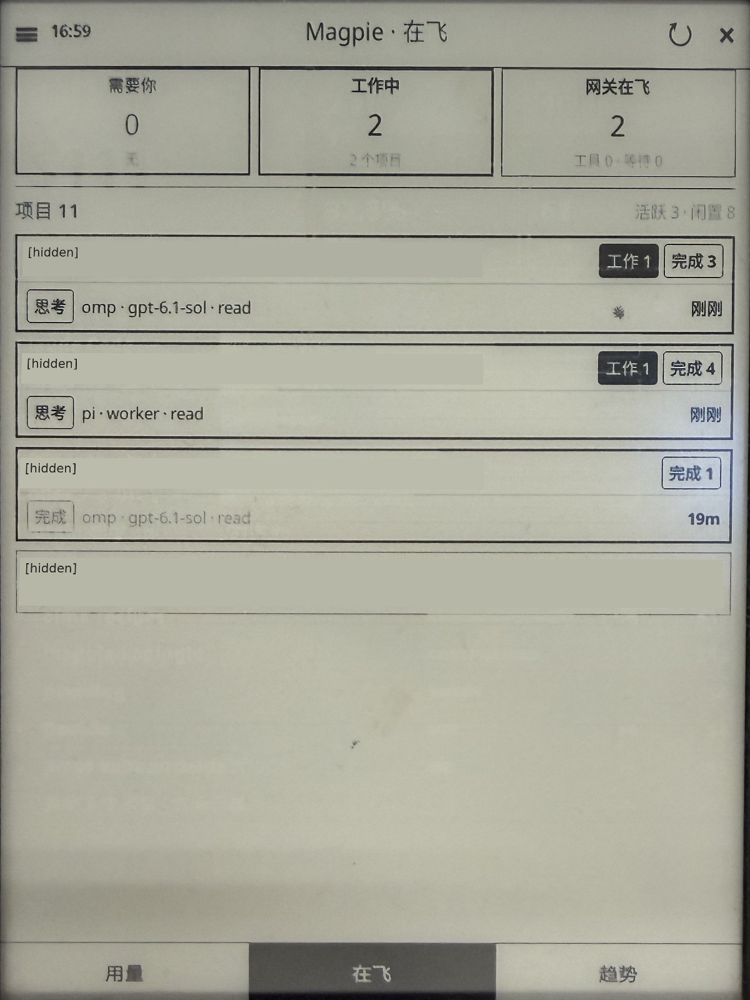

# Magpie

**English | [简体中文](./README.zh-CN.md)**

[](./LICENSE)
[](https://koreader.rocks/)

A read-only [KOReader](https://koreader.rocks/) dashboard for your own [Magpie](https://usemagpie.ai/) services: usage, quotas, project costs, in-flight work, and trends.

The plugin runs on the reader; Gateway, Web, and Agent Office run on your own host. It sends GET requests and does not change Magpie configuration. The interface is Chinese; both README languages describe the same plugin.

[Feature](#feature) · [Install](#install) · [Usage](#usage) · [Dev](#dev)

| Today’s usage | In-flight work | 30-day trends |
| --- | --- | --- |
|  |  |  |

Photos from the maintainer’s confirmed real-device use; account and project labels are hidden.

## Feature

Three pages: **今日用量** (today’s usage), **在飞** (in-flight work), and **趋势** (trend).

| Capability | What you see | Requires |
| --- | --- | --- |
| Usage | Cost, calls, tokens; cache, decode speed, session count, and TTFT when supplied | Gateway and your Gateway key |
| Quotas | Primary quota windows and reset times; visibility follows key permissions | Gateway quota permission |
| Project costs | Costs grouped by the last directory name; small and unattributed spend in a remainder row | Magpie Web and its admin key |
| In-flight work | Projects grouped by attention, work, completion, and idle state; open a project for session detail | Web and enabled Agent Office |
| Trends | Today / 7 days / 30 days, cost or calls; multi-day cost can stack the largest projects | Gateway; Web for project breakdowns |

The today chart and calls charts use plain bars. Project costs appear on the usage page and for the selected trend period. Gateway in-flight counts accompany the project view.

The dashboard refreshes every 60 seconds by default while open. Closing it or suspending the device stops the timer. A saved `auto_refresh_sec` preference is kept; there is no menu to edit it. Opening or resuming does not stack timers. Failed items keep their last successful data with an error; a first failure shows an unavailable state.

This repository contains the plugin, not the backends. It provides no default server, demo backend, RSS, weather, reading statistics, sync, or home-screen replacement. It uses KOReader’s own UI, network, and JSON libraries and is not an official KOReader component.

**Status:** version `0.4.0`, user-agent `magpie-koreader/0.4.0`; no Git tag or published release ZIP.

**Real-device use:** the maintainer has confirmed actual use on their reader. The photos are accepted evidence for usage, quotas, project costs, the in-flight project list, and 30-day cost trends. The exact device and software/build versions are not yet recorded; no minimum KOReader version or compatibility with other devices is claimed. Independent first use and store compatibility remain unverified. See [validation status](https://github.com/blizhan/magpie.koplugin/blob/main/docs/release-readiness.md).

---

## Install

### 1. Copy the plugin

You need Git, a POSIX shell, and writable access to your reader’s KOReader storage. Find the `plugins` directory belonging to that installation; the path varies by device.

```sh
git clone https://github.com/blizhan/magpie.koplugin.git
cd magpie.koplugin
printf 'KOReader plugins directory: '
IFS= read -r KOREADER_PLUGINS
test -n "$KOREADER_PLUGINS" && test -d "$KOREADER_PLUGINS" || exit 1
mkdir -p "$KOREADER_PLUGINS/magpie.koplugin"
cp _meta.lua main.lua dashview.lua office.lua projcost.lua LICENSE README.md README.zh-CN.md "$KOREADER_PLUGINS/magpie.koplugin/"
```

Copy these eight files only. The installed entry must be `plugins/magpie.koplugin/_meta.lua`, with no second nested plugin directory. If you build a ZIP using Dev below, extract its single `magpie.koplugin/` root into the same `plugins` directory. Configuration lives outside the plugin directory.

### 2. Configure Gateway

Follow [Usage](#usage) to prepare your own Gateway and write `base_url.txt` and `gateway-key.txt` under KOReader’s settings directory, in `magpie/`. Web and Agent Office are optional for project features.

### 3. Open the dashboard

Fully quit KOReader and start it again. Open:

**工具 → 更多工具 → Magpie 看板 → 打开看板**

Refresh and compare cost, calls, and tokens with what your Gateway key can see. Quotas appear only when that key has permission. Without configuration, the dashboard shows the missing files and sends no request for that side.

---

## Usage

### Prepare your backends

1. Install an official Magpie build from [usemagpie.ai/#cli](https://usemagpie.ai/#cli).
2. Enable [LAN sharing](https://usemagpie.ai/docs/remote#share). Use the Address line’s reachable Gateway URL, not a host your reader cannot access.
3. Create a key in the Gateway keys UI, or run this on your Magpie host:

   ```sh
   magpie gateway-key add "Kindle"
   ```

   The label is only a name. Grant the quota visibility you need; a restricted key may not see global data. Do not widen permissions just to fill a panel.

For project costs and in-flight work, also start Magpie Web with your own admin key. This example uses OpenSSL to generate one; keep it privately for the device configuration:

```sh
export MAGPIE_WEB_KEY="$(openssl rand -hex 16)"
magpie web --addr 0.0.0.0:3430 --no-open
```

The [official Web CLI source](https://github.com/yetone/magpie/blob/4869d0c9665e1a815fee3a1a4d67a575e0baab93/internal/cli/web_cli.go) documents this invocation. Give the reader a reachable host address and the actual port, not `0.0.0.0`. An existing Web or daemon process may be reused: a new environment variable does not replace that process’s key. Use the key of the process actually serving the page. The Web port is never inferred from Gateway.

In-flight project cards also need Agent Office on that same Web process:

```sh
magpie plugin add @magpie-community/page-agent-office
```

**In-flight display is confirmed on the maintainer’s reader.** Reproducing the public Office installation is still pending: a registry lookup returned 404, and the actual installation method and backend versions have not been recorded. Source package metadata requires Magpie ≥ 0.1.1318; that is not a tested version range. If the package is unavailable, follow the plugin author’s published source-install instructions and record the version and result. This remaining installation check does not negate the confirmed real-device use.

### Write the four configuration files

The directory is `DataStorage:getSettingsDir() .. "/magpie/"`, typically `settings/magpie/` in the KOReader data directory. Create it if needed. Use your installation’s settings location, not the plugin directory.

| File | Needed for | Example value |
| --- | --- | --- |
| `base_url.txt` | Gateway usage, trends, and quotas | `http://gateway.example.invalid:8080` |
| `gateway-key.txt` | Gateway authentication | `EXAMPLE_ONLY_NOT_A_REAL_KEY` |
| `web_url.txt` | Project costs and in-flight work | `http://web.example.invalid:3430` |
| `web-key.txt` | Web authentication | `EXAMPLE_ONLY_NOT_A_REAL_KEY` |

These are fictional, unusable examples. Put your own value in each file on the device. Each file uses the first trimmed line that is non-empty and does not start with `#`. Empty, comment-only, or unreadable files count as unset; errors never echo their contents.

- Gateway URLs support `http` or `https`; Web supports `http` only. URLs need a non-empty host and must not contain user information, a query, or a fragment. Trailing slashes are removed; unsupported schemes are rejected without downgrade.
- The Web key must have at least 16 characters, using only letters, digits, and `-._~`. Invalid keys send no Web request.
- **网关地址…** edits only `base_url.txt` and reports write failures. It never displays a key. Edit the Web URL and both keys through their files.
- Every manual or timed refresh rereads configuration. Changing a URL or key clears that side’s cache; Web also clears its memory-only cookie and discovered Office path. Gateway and Web operate independently, and incomplete pairs send no request.

With Gateway configured, verify usage and switch the trend period and metric. With Web configured, project costs appear on usage and trend pages. With Agent Office enabled, open a project on the in-flight page to see session detail.

### Navigate and refresh

| Control | Action |
| --- | --- |
| Swipe left / right | Next / previous page; right from a project detail returns to the list |
| Swipe down or **↻** | Refresh |
| **用量 / 在飞 / 趋势** | Switch pages |
| **×** | Close |
| Dispatcher `magpie_open` / `magpie_refresh` | Open / refresh through gestures or profiles you assign |

The tool menu also offers **刷新数据**, **用量页**, **在飞页**, **趋势页**, and **网关地址…**.

### Errors and recovery

| Situation | Result and next step |
| --- | --- |
| Missing configuration or an invalid URL/key | That side sends no request. Check the named files and supported protocol. |
| Network failure, bad key, HTTP error, or malformed JSON | Error category/status only; cached items are marked stale. Correct the cause and refresh. Other successful items still update. |
| Trend period changes and its request fails | Data from another period is not shown under the new label. Retry that period. |
| Quota permission denied | Permission explanation, distinct from an empty successful quota response. Cached quotas retain a failure warning until recovery. |
| Empty quota or project statistics | Empty state, not a network error. |
| Web missing or Office disabled | Gateway usage still works. Configure Web or enable Office for the affected feature. |
| Web returns 401 | Sign in and retry once, then stop on another failure. Login never follows redirects. |
| Discovered Office path returns 404 | Clear the path and discover it once again. |

### Upgrade, migration, and removal

- **Upgrade:** replace the plugin directory and fully restart KOReader. `settings/magpie/` and non-sensitive preferences in `settings/magpie.lua` remain.
- **Migrate an older install:** manually copy your URL/key values into the four files above. This version does not read old external paths, a plugin `apikey.txt`, or settings credentials. On load it removes legacy `api_key` and `base_url` fields from `magpie.lua`, saves other preferences including refresh interval and user-agent, and never connects using the removed values. Old files, backups, and synced copies remain; remove secret-bearing leftovers yourself.
- **Uninstall:** delete `plugins/magpie.koplugin/`. To remove its configuration too, explicitly delete `settings/magpie/` and `settings/magpie.lua`; leave other KOReader settings intact.

### Security and data

- The Web key is an **admin credential**, not a read-only dashboard token. Its holder can change Magpie and view keys, even though this plugin only sends GET requests.
- Web uses HTTP and logs in with `GET /?k=<web-key>`. Server/proxy/access logs may retain the query string; the plugin cannot control those logs. Cookies stay in memory.
- Gateway HTTPS does **not verify certificates** in this client. Web has no HTTPS support and does not downgrade an HTTPS URL to HTTP.
- Directory mode `0700` and written-file mode `0600` are best-effort. FAT ignores those bits; protection depends on device access control.
- Keep real keys, credential URLs, cookies, private hosts, settings, and key-bearing command history out of issues and attachments. Project names, session titles, and screenshots can be personal; share synthetic examples.

---

## Dev

### Local checks

You need Git, a POSIX shell, and LuaJIT. Packaging needs `zip`, archive inspection needs `unzip`, and release privacy checks need Gitleaks **8.x**. The optional Web key-generation example uses OpenSSL.

From the repository root:

```sh
luajit tests/run.lua
```

The runner uses temporary settings and synthetic responses, with a nonzero exit on failure. It does not read real device configuration or keys. It does not prove a real Gateway/Web/Office installation, KOReader rendering, touch interaction, timers, suspend, or restart behavior. Request/UI changes also need your own reachable host, backends, and KOReader.

### Package

Use the version already declared in `_meta.lua`:

```sh
sh scripts/package.sh 0.4.0
unzip -Z1 dist/magpie.koplugin-0.4.0.zip
```

The archive has one `magpie.koplugin/` root and the eight Install files. The script rejects an existing output; keep older candidates separate. Packaging does not establish release acceptance.

Privacy checks cover proposed history, public source, and a temporarily unpacked candidate, using `gitleaks git --redact .`, `gitleaks dir --redact .`, and `gitleaks dir --redact` on the unpacked directory. Review private addresses, paths, names, and attachments manually too. Classify findings rather than treating a scanner result as proof; never publish a report containing secrets.

### Contribute and report issues

Open a [GitHub issue](https://github.com/blizhan/magpie.koplugin/issues) with a reproducible problem or bounded proposal. Fork/clone, create a branch, make one bounded change, and run the local checks. For request/UI changes, exercise success and failure paths on your own backend and KOReader. Submit a [pull request](https://github.com/blizhan/magpie.koplugin/pulls) describing the change, checks actually run, and unavailable dependencies.

Bug reports should include plugin/KOReader versions, device model (no serial number or account), page, expected behavior, error category, and HTTP status. Exclude real settings, response bodies, `live.js`, session contents, credentials, and unsanitized logs or screenshots.

### Documentation and validation

- [Validation record](https://github.com/blizhan/magpie.koplugin/blob/main/docs/release-readiness.md) — observed checks, candidates, and remaining gates.
- [Acceptance quickstart](https://github.com/blizhan/magpie.koplugin/blob/main/specs/001-open-source-magpie/quickstart.md) — actual-device, backend, and independent first-use steps.
- [Provenance](https://github.com/blizhan/magpie.koplugin/blob/main/docs/provenance.md) — source and MIT redistribution record.
- [Community routes](https://github.com/blizhan/magpie.koplugin/blob/main/docs/community.md) — discovery, listing, and store-installation status.

Remaining release checks cover a clean install from the final candidate ZIP; feature, error-recovery, and lifecycle cases outside the photos; environment/build version records; independent Chinese and English first use within 30 minutes each; and an external developer’s bounded change within 60 minutes. These are tracked separately from the accepted real-device results, so overall release acceptance remains **BLOCKED**.
